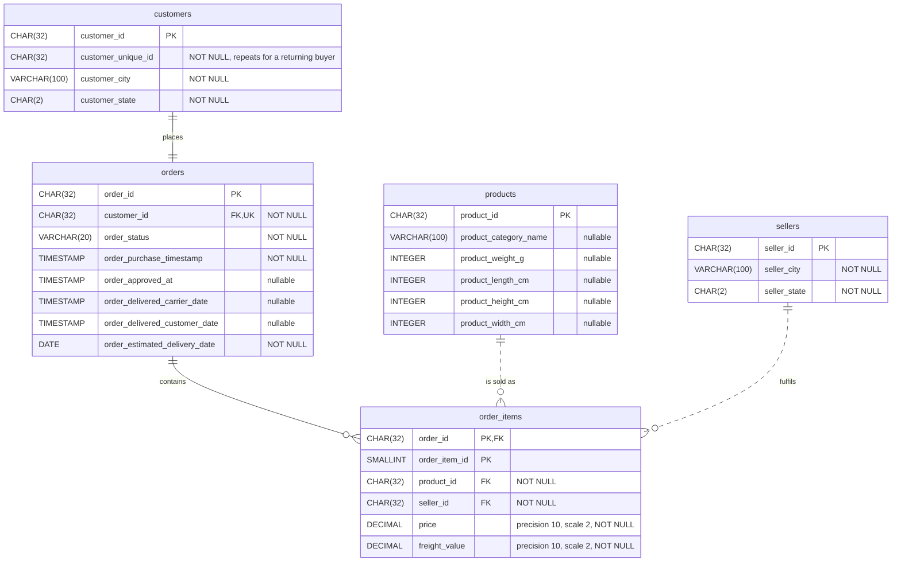

# Entity-relationship diagram

The source schema has five tables. The diagram uses crow's foot notation throughout and matches `schema.sql` column for column. An exported image is in [erd.png](erd.png).

## Reading the diagram

Each end of a line carries two marks. The mark nearest the table gives the cardinality (the maximum: a bar for one, a crow's foot for many). The mark behind it gives the participation (the minimum: a bar for mandatory, a circle for optional). `PK` is a primary key column, `FK` a foreign key column, and `UK` a UNIQUE column. A solid line means the child's primary key contains the parent's key; a dashed line means it does not.

| Relationship | Cardinality | Participation | Enforced by |
|---|---|---|---|
| customers to orders | One to one. Olist issues a new `customer_id` for every order. | Mandatory on both sides: every order has a customer and every customer has an order. | `fk_orders_customers`, NOT NULL and `uq_orders_customer_id` on `orders.customer_id`. That every customer has an order is confirmed by a verification query (0 customers without an order). |
| orders to order_items | One to many. | An item must belong to an order. An order may have no items: 76 orders in the subset have none (55 unavailable, 21 canceled). | `fk_order_items_orders`; `order_id` is part of `pk_order_items`. |
| products to order_items | One to many. | An item must name a product. A product may exist without items. | `fk_order_items_products`, NOT NULL. |
| sellers to order_items | One to many. | An item must name a seller. A seller may exist without items. | `fk_order_items_sellers`, NOT NULL. |

## Many-to-many relationships

An order can hold several products and a product appears in many orders. The same is true of orders and sellers. Neither relationship is stored as a column on `orders`. Both are resolved by `order_items`, the associative table: each row links one order to one product and one seller, and carries the price and freight of that item. Its key is (`order_id`, `order_item_id`) and not (`order_id`, `product_id`), because the same product can occupy several item positions in one order.
